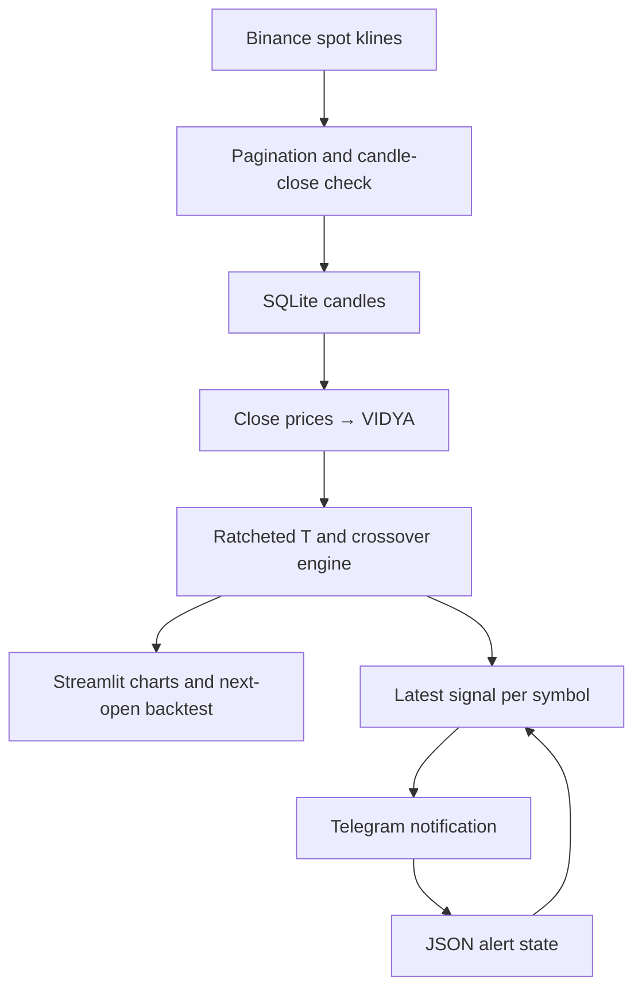

# Ratchet VIDYA Alerts

A Python application that computes **VIDYA (VMA)** and a **single ratcheted tracking line (T)** from Binance spot candle data, detects **LONG/SHORT crossovers between those two lines**, and optionally sends Telegram notifications.

The project includes a Streamlit dashboard, a simple next-open backtest, SQLite candle storage, JSON alert state, and a scheduled GitHub Actions workflow. It does not place exchange orders.

## Contents

- [Features](#features)
- [Architecture](#architecture)
- [Indicator and signal rules](#indicator-and-signal-rules)
- [Local setup](#local-setup)
- [Dashboard](#dashboard)
- [Telegram alerts](#telegram-alerts)
- [Configuration reference](#configuration-reference)
- [GitHub Actions](#github-actions)
- [Storage and alert state](#storage-and-alert-state)
- [Backtest model](#backtest-model)
- [Python API](#python-api)
- [Project structure](#project-structure)
- [Tests](#tests)
- [Known limitations](#known-limitations)
- [Troubleshooting](#troubleshooting)

## Features

- Fetches OHLCV candles through Binance's public market-data endpoint; the code does not require a Binance API key.
- Paginates historical requests and removes duplicate candle opening timestamps.
- Excludes the final fetched candle when it has not closed, with a configurable timing buffer.
- Implements CMO-based VIDYA using closing prices.
- Computes one tracking line that ratchets upward in a LONG regime and downward in a SHORT regime.
- Generates signals exclusively from VMA–T crossovers, with immediate tracking-line re-anchoring.
- Displays VMA, T, signal markers, recent signals, and a separate backtest equity chart.
- Processes multiple symbols sequentially in the alert job.
- Supports batched or individual Telegram messages with a TradingView symbol link.
- Stores the last selected alert per symbol and interval to suppress exact repeats.

There are no ATR bands, price-cross signals, additional confirmation filters, stop-loss rules, or take-profit rules.

## Architecture



Both the dashboard and the alert job use `src.jobs.fetch_binance_and_run.run()`. This function fetches data, updates SQLite, reads stored candles, and returns aligned candle and indicator DataFrames.

The alert job then selects the most recent signal in the returned history, compares it with JSON state, and queues it for notification. It does **not** send every unseen historical signal or require the signal to belong to the newest closed candle.

## Indicator and signal rules

### 1. VIDYA / VMA

The input is the candle closing-price series. For a momentum window of `momentum_length`:

```text
change[t]   = close[t] - close[t-1]
up[t]       = max(change[t], 0)
down[t]     = max(-change[t], 0)

sum_up      = rolling_sum(up, momentum_length)
sum_down    = rolling_sum(down, momentum_length)
CMO[t]      = 100 × (sum_up - sum_down) / (sum_up + sum_down)

base_alpha  = 2 / (vma_length + 1)
alpha[t]    = base_alpha × abs(CMO[t]) / 100
VMA[t]      = alpha[t] × close[t] + (1 - alpha[t]) × VMA[t-1]
```

When the CMO denominator is zero, CMO is set to zero. Values before the first valid momentum window remain unavailable. The first valid VMA value is initialized to the closing price at that index; initialization itself does not generate a signal.

### 2. Percent offset and provisional tracking line

```text
delta[t] = VMA[t] × offset_pct / 100
```

`offset_pct=1.0` means a 1% offset. The offset must be positive.

| Current regime | Provisional T update | Behavior within the regime |
| --- | --- | --- |
| LONG | `max(T[t-1], VMA[t] - delta[t])` | T cannot decrease |
| SHORT | `min(T[t-1], VMA[t] + delta[t])` | T cannot increase |

The initial regime defaults to `LONG`. On the first valid VMA bar, T is initialized below VMA for LONG or above VMA for SHORT by the calculated offset.

### 3. Crossover detection and re-anchoring

The engine first computes provisional T, then tests the crossover:

| Signal | Previous bar | Current bar | Final T on the signal bar |
| --- | --- | --- | --- |
| LONG | `VMA[t-1] <= T[t-1]` | `VMA[t] > provisional_T[t]` | `VMA[t] - delta[t]` |
| SHORT | `VMA[t-1] >= T[t-1]` | `VMA[t] < provisional_T[t]` | `VMA[t] + delta[t]` |

A signal changes the regime and immediately re-anchors T. Monotonic movement applies within a regime; re-anchoring at a regime change can move T in the opposite direction. The plotted T is the **final, re-anchored value**, while crossover detection uses the provisional value.

The complete engine lives in `src/signals/vma_t_crossover.py`. The separate `ratcheted_tracking_line()` helper in `src/indicators/ratchet_t.py` keeps its initial regime fixed and does not implement crossover-driven regime changes.

## Local setup

### Requirements

- Python **3.11**, matching the repository's GitHub Actions and devcontainer configuration.
- `pip` and a virtual environment.
- Network access to the configured Binance endpoint for fetching market data.
- Telegram bot credentials only when sending notifications.

The pinned dependencies are Streamlit 1.41.1, python-dotenv 1.0.1, pandas 2.2.3, NumPy 2.1.3, pytest 8.3.4, Plotly 5.24.1, and requests 2.32.3. SQLite is accessed through Python's standard library.

### Install

Extract or clone the project, open a terminal in its root directory, and run:

```bash
python3.11 -m venv .venv
source .venv/bin/activate
python -m pip install -r requirements.txt
```

On Windows PowerShell, activate the environment with:

```powershell
.\.venv\Scripts\Activate.ps1
```

Run the commands below from the project root so that `src` imports and relative storage paths resolve consistently.

### Fetch and compute without notifications

```bash
python -m src.jobs.fetch_binance_and_run
```

This entry point uses the function defaults: `BTCUSDT`, `1h`, 30 days, VMA length 20, momentum length 9, offset 1%, initial LONG regime, and `data.db`. It prints the output-row and signal counts.

This command does not load `.env` or map alert-job settings such as `SYMBOL` into function arguments. Use the [Python API](#python-api) for custom computation parameters, or the alert entry point for environment-based configuration.

### Devcontainer / Codespaces

The included `.devcontainer/devcontainer.json` uses a Python 3.11 image, installs `requirements.txt`, sets the project root as `PYTHONPATH`, and forwards port 8501. Start Streamlit manually after the container is ready.

## Dashboard

On Linux/macOS:

```bash
PYTHONPATH=. python -m streamlit run src/ui/app.py
```

On Windows PowerShell:

```powershell
$env:PYTHONPATH = "."
python -m streamlit run src/ui/app.py
```

Open the local URL printed by Streamlit, normally `http://localhost:8501`, and click **Fetch & Compute (Binance)**.

| Control | Available values / range | Default |
| --- | --- | --- |
| Symbol | Binance symbol text | `BTCUSDT` |
| Interval | `1m`, `5m`, `15m`, `1h`, `4h`, `1d` | `1h` |
| Lookback days | 1–180 | 30 |
| Offset (%) | 0.1–10.0 | 1.0 |
| VMA length | 5–80 | 20 |
| Momentum length | 2–40 | 9 |
| Initial direction | `LONG`, `SHORT` | `LONG` |
| Transaction cost (bps) | 0–50 | 10 |

The indicator chart contains exactly two lines, VMA and T, plus discrete LONG/SHORT markers. A table shows the last 30 signals, followed by backtest statistics and a separate equity chart.

The dashboard uses its widget values and the default `data.db` path. It does not load `.env`, send Telegram messages, or automatically refresh market data. Export low-level settings such as `BINANCE_BASE_URL` in the launching shell if needed.

## Telegram alerts

### Configure the job

Create a `.env` file in the project root:

```dotenv
SYMBOLS=BTCUSDT,ETHUSDT
INTERVAL=1h
LOOKBACK_DAYS=30
VMA_LENGTH=20
MOMENTUM_LENGTH=9
OFFSET_PCT=1.0
INITIAL_DIR=LONG

BINANCE_BASE_URL=https://data-api.binance.vision
DB_PATH=data.db
STATE_PATH=state/local_alerts_state.json
CANDLE_CLOSE_SAFETY_MS=2000

TELEGRAM_BOT_TOKEN=replace_with_your_bot_token
TELEGRAM_CHAT_ID=replace_with_your_chat_id
BATCH_ALERTS=true
MAX_ALERTS_PER_RUN=20
LOCAL_TZ=Europe/Istanbul
TV_EXCHANGE=BINANCE
```

Use credentials for a bot that can send to the configured chat. `.env` is ignored by Git. The local state path above deliberately separates your run from the historical alert state shipped in the archive.

Run one alert scan:

```bash
python -m src.jobs.run_and_alert
```

This entry point calls `load_dotenv()`; existing shell environment values take precedence over `.env`. It performs one scan and exits. Recurring execution comes from an external scheduler, such as the included GitHub Actions workflow.

**Missing credentials are not a dry-run mode.** If either Telegram variable is empty, the sender returns without making a request, but the caller still logs a send and saves alert state. To inspect signals without advancing alert state, use the dashboard or computation entry point.

### Message contents

Each alert contains:

- Symbol, interval, and signal direction.
- The signal candle's **opening timestamp**, in UTC and the configured local timezone.
- Opening timestamp in Unix milliseconds.
- VMA, final T, and the regime after the signal.
- Indicator parameters and a TradingView symbol link.

The timestamp identifies the candle; it is not the notification time or candle closing time. The TradingView link opens the symbol and does not install this custom indicator or configure its parameters.

### Selection and delivery behavior

1. Parse `SYMBOLS`, trimming whitespace, uppercasing symbols, and removing duplicates while preserving order. Fall back to `SYMBOL` when the list is absent or blank.
2. Fetch and compute each symbol sequentially using one shared interval and parameter set.
3. Select only the latest signal in the computed history.
4. Skip it when its `{open_time, signal_type}` exactly matches stored state.
5. Queue at most `MAX_ALERTS_PER_RUN` alerts.
6. Send one combined message by default, or individual messages when batching is disabled.
7. Save updated JSON state after the send stage returns.

Errors during one symbol's processing are logged and the next symbol is attempted. Telegram send errors occur outside that per-symbol handler and can fail the job. Delivery and state persistence are not an atomic transaction; see [known limitations](#known-limitations).

## Configuration reference

These are defaults in the source code. Most job-level settings are read by `src.jobs.run_and_alert`; the dashboard and standalone computation command have the differences described above.

| Variable | Default | Purpose |
| --- | --- | --- |
| `SYMBOLS` | Unset | Comma-separated symbols; takes precedence over `SYMBOL` when nonblank. |
| `SYMBOL` | `BTCUSDT` | Single-symbol fallback. |
| `INTERVAL` | `1h` | Candle interval passed to the data endpoint. |
| `LOOKBACK_DAYS` | `30` | Fetch request window in days; not a strict filter on existing SQLite history. |
| `VMA_LENGTH` | `20` | Positive VIDYA smoothing length. |
| `MOMENTUM_LENGTH` | `9` | Positive CMO window length. |
| `OFFSET_PCT` | `1.0` | Positive percentage distance between VMA and the candidate T. |
| `INITIAL_DIR` | `LONG` | Initial regime: `LONG` or `SHORT`. |
| `BINANCE_BASE_URL` | `https://data-api.binance.vision` | Base URL for `/api/v3/klines`. |
| `CANDLE_CLOSE_SAFETY_MS` | `2000` | Buffer used when checking the final fetched candle. |
| `DB_PATH` | `data.db` | SQLite file used by the alert job. |
| `STATE_PATH` | `state/alerts_state.json` | JSON file used for alert repeat suppression. |
| `TELEGRAM_BOT_TOKEN` | Empty | Telegram bot token. |
| `TELEGRAM_CHAT_ID` | Empty | Destination Telegram chat ID. |
| `BATCH_ALERTS` | `true` | Combine queued alerts into one message. |
| `MAX_ALERTS_PER_RUN` | `20` | Maximum queued alerts per invocation, not a message-length limit. |
| `LOCAL_TZ` | `Europe/Istanbul` | Local timezone shown alongside UTC; falls back to UTC if unavailable or invalid. |
| `TV_EXCHANGE` | `BINANCE` | Exchange prefix in TradingView links. |
| `LOG_LEVEL` | `INFO` | Logging level; set in the shell or workflow before Python starts. |

Truthy values for `BATCH_ALERTS` are `1`, `true`, `yes`, `y`, and `on`, case-insensitively. Other explicitly supplied values are false. Logger instances are created before `.env` is loaded, so a `.env`-only `LOG_LEVEL` setting may not configure those existing loggers.

## GitHub Actions

The workflow is defined in `.github/workflows/scheduled_alerts.yml` and supports scheduled and manual invocation.

```yaml
schedule:
  - cron: "5 * * * *"
workflow_dispatch: {}
```

The configured schedule targets minute **05 of every hour**. It is independent of `INTERVAL`: changing the candle interval does not change the workflow frequency.

### Repository configuration

1. Put the project in a GitHub repository with the workflow enabled.
2. Configure repository Actions secrets `TELEGRAM_BOT_TOKEN` and `TELEGRAM_CHAT_ID`.
3. Optionally configure the repository variables listed below.
4. Ensure the workflow can push the updated state file to its branch; its declared permission is `contents: write`.
5. Run **Scheduled Alerts** manually and inspect its logs and state update.

| Repository variable | Workflow fallback |
| --- | --- |
| `SYMBOLS` | Empty; falls back to `SYMBOL` |
| `SYMBOL` | `BTCUSDT` |
| `INTERVAL` | `1h` |
| `LOOKBACK_DAYS` | `30` |
| `VMA_LENGTH` | `20` |
| `MOMENTUM_LENGTH` | `9` |
| `OFFSET_PCT` | `1.0` |
| `INITIAL_DIR` | `LONG` |

The workflow explicitly sets `BINANCE_BASE_URL`, `LOG_LEVEL=INFO`, and `STATE_PATH=state/alerts_state.json`. Other settings, such as `BATCH_ALERTS`, are not wired to repository variables; add them to the workflow's `env` block if you need to override their code defaults.

After the alert job, the workflow commits and pushes changes to `state/alerts_state.json`. SQLite is not cached or uploaded, so it is rebuilt on each hosted run. Concurrency is grouped by Git ref, with `cancel-in-progress: true`: a new invocation can cancel an older one on the same ref.

Use a schedule appropriate for the candle interval. With a short interval and hourly execution, several crossovers may occur between runs, while the job only selects the latest one. The workflow does not run the test suite.

## Storage and alert state

### SQLite

The database uses WAL journal mode and contains two tables:

| Table | Primary key | Stored data |
| --- | --- | --- |
| `candles` | `(symbol, interval, open_time)` | OHLCV values and candle closing timestamp. |
| `signals` | `(symbol, interval, open_time)` | Direction, VMA, T, and regime for a signal bar. |

Candle writes use `INSERT OR REPLACE`. Signal writes use `INSERT OR IGNORE`, but signal persistence is **opt-in**: neither the dashboard nor the alert job calls `persist_signals()` automatically.

Candle DataFrames use a UTC `open_dt` index. Opening and closing timestamps are stored as Unix milliseconds.

**Current query behavior:** `run()` reads up to 5,000 stored candles using `ORDER BY open_time ASC LIMIT 5000`. This selects the oldest stored candles, not the newest. On a long-lived database, computations can stop including recent candles after the limit is reached. Existing history is also not filtered by the current `LOOKBACK_DAYS` setting. Use an isolated database for reproducible experiments and account for this limitation before continuous local operation.

### JSON state

The state key is `SYMBOL__interval`:

```json
{
  "BTCUSDT__1h": {
    "open_time": 1735689600000,
    "signal_type": "LONG"
  }
}
```

The archive includes a populated `state/alerts_state.json`. It represents previous alert state, not an empty installation. For independent local use, choose a new `STATE_PATH`, as in the setup example. For a fresh deployment, deliberately initialize the deployment state to `{}` if previous alert history should not be retained.

A missing file or invalid JSON is treated as empty state. Starting with empty state can send the latest historical signal immediately. Removing or resetting state makes previously suppressed alerts eligible again.

State contains no indicator parameters, delivery receipt, or running VMA/T values. It suppresses only an exact match with the last saved payload; it is not a complete alert ledger or an exactly-once delivery mechanism.

## Backtest model

`backtest_next_open()` models a signal confirmed on candle `t` as a position change at candle `t+1`'s opening price:

- Start flat (`0`) until the first executable signal.
- A LONG signal sets position to `+1` at the next open.
- A SHORT signal sets position to `-1` at the next open.
- Hold the position until another signal changes it.
- Ignore a final-bar signal for execution when there is no next bar.

```text
open_ret[t]     = open[t] / open[t-1] - 1
trade_cost[t]   = abs(position[t] - position[t-1]) × fee_bps / 10,000
strategy_ret[t] = position[t-1] × open_ret[t] - trade_cost[t]
equity[t]       = cumulative_product(1 + strategy_ret[t])
```

A 10 bps fee means 0.1% per unit of position change. Reversing from `+1` to `-1` has magnitude 2 and incurs twice that cost. The function default is zero fees; the dashboard default is 10 bps.

`summary_stats()` returns total return, maximum drawdown as a nonpositive fraction, and the number of position changes. Position changes are not a count of completed round-trip trades.

This is a simplified analytical model: it does not model slippage, spread, funding, borrow costs, liquidation, order fills, or final forced liquidation. SHORT is a simulated negative position on spot price data; the application does not execute a spot short or a futures trade.

## Python API

### Fetch, calculate, and optionally persist signals

```python
from src.jobs.fetch_binance_and_run import run, persist_signals
from src.analysis.backtest import backtest_next_open, summary_stats

candles, indicators = run(
    symbol="ETHUSDT",
    interval="1h",
    lookback_days=30,
    vma_length=20,
    momentum_length=9,
    offset_pct=1.0,
    initial_dir="LONG",
    db_path="data/eth_analysis.db",
)

if not candles.empty and not indicators.empty:
    signal_rows = indicators[
        indicators["long_signal"] | indicators["short_signal"]
    ]
    print(signal_rows.tail())

    backtest = backtest_next_open(candles, indicators, fee_bps=10.0)
    print(summary_stats(backtest))

    inserted = persist_signals(
        candles, indicators,
        symbol="ETHUSDT", interval="1h",
        db_path="data/eth_analysis.db",
    )
    print(f"New signal rows stored: {inserted}")
```

The output columns are `vma`, `T`, `dir`, `delta`, `long_signal`, and `short_signal`. Early VMA/T values can be unavailable during initialization. Backtest inputs must have identical indexes.

### Compute from an existing price series

```python
import pandas as pd
from src.indicators.vidya import vidya
from src.signals.vma_t_crossover import compute_t_and_signals_from_vma

close = pd.Series([100, 102, 105, 108, 107, 103, 99, 98, 102, 107, 110])
vma = vidya(close, vma_length=3, momentum_length=2)
result = compute_t_and_signals_from_vma(
    vma, offset_pct=1.0, initial_dir="LONG"
)
print(result)
```

This second example is offline and does not access Binance, Telegram, or SQLite.

## Project structure

```text
.
├── .devcontainer/devcontainer.json       # Python 3.11 development container
├── .github/workflows/scheduled_alerts.yml # Scheduled alerts and state commits
├── docs/
│   ├── design-decision.md               # Choice of CMO-based VIDYA
│   └── requirements.md                  # Indicator rules and acceptance criteria
├── src/
│   ├── alerts/telegram.py               # Telegram sendMessage client
│   ├── analysis/backtest.py             # Next-open model and summary statistics
│   ├── indicators/
│   │   ├── vidya.py                     # Adaptive moving average
│   │   └── ratchet_t.py                 # Fixed-regime ratchet helper
│   ├── ingestion/binance_spot.py         # Kline requests, pagination, parsing
│   ├── jobs/
│   │   ├── fetch_binance_and_run.py      # Shared computation and optional persistence
│   │   └── run_and_alert.py              # Multi-symbol alert orchestration
│   ├── signals/vma_t_crossover.py        # Full regime-changing signal engine
│   ├── storage/
│   │   ├── sqlite_store.py              # Candle and signal tables
│   │   └── state_file.py                # JSON notification state
│   ├── ui/app.py                        # Streamlit dashboard
│   └── utils/
│       ├── candles.py                   # Final-candle close check
│       └── logging.py                   # Logger configuration
├── state/alerts_state.json              # Tracked historical alert state
├── tests/                               # Unit tests
├── pytest.ini
├── requirements.txt
└── README.md
```

For the original specification and implementation rationale, see [requirements](docs/requirements.md) and [design decision](docs/design-decision.md). This README describes the current implementation, including operational limitations beyond those requirements.

## Tests

After installing dependencies:

```bash
python -m pytest -q
```

The repository contains 13 unit tests across five files:

| Area | Covered behavior |
| --- | --- |
| VIDYA | Index alignment, constant-series stability, invalid smoothing length. |
| Fixed-regime T | LONG/SHORT monotonicity and deterministic initialization. |
| Signal engine | LONG/SHORT re-anchoring and monotonicity within regimes. |
| Candle filtering | Keeping closed candles and dropping an unclosed final candle. |
| Backtest | Next-open position shift and transaction cost application. |

These tests use local synthetic data. They do not verify live Binance requests, Telegram delivery, SQLite query freshness, JSON persistence, workflow execution, or dashboard rendering.

## Known limitations

The following describe existing code behavior, not implemented fixes:

1. **Oldest-5,000-candle query.** The shared pipeline can use stale history once a stored series exceeds 5,000 rows. Requested lookback does not trim existing storage.
2. **Latest-signal selection only.** There is no replay of all missed signals, freshness threshold, or check that a newly selected payload is chronologically newer than saved state. An initial run can notify about an older historical signal.
3. **History-dependent initialization.** VIDYA and T are recomputed from the available stored history. Different database contents or rolling fetch windows can change initialization and later values. JSON state does not preserve indicator continuity.
4. **Credentials missing still advances state.** The Telegram helper silently returns when configuration is incomplete; callers cannot distinguish that from a successful send.
5. **Delivery is not atomic with persistence.** A crash or failed Git push after sending can produce duplicate notifications on a later run. In individual-message mode, state is written only after the entire send loop, so a later send failure can lose state updates for earlier successful sends.
6. **No batch-size splitting or send retry.** Combined messages are not split by character length. A large batch may be rejected by Telegram. No general retry/backoff mechanism exists for Telegram, network timeouts, or Binance rate-limit responses.
7. **Limited HTTP fallback.** Binance requests retry against the market-data endpoint only for HTTP 451 from a different configured base URL. A failure on the default endpoint has no additional fallback.
8. **Limited state safeguards.** JSON writes are direct, without locking or atomic replacement. Invalid JSON resets state to empty, and successfully parsed content is not schema-validated. Separate local processes sharing one file can overwrite each other's updates.
9. **Partial failure can look successful.** Per-symbol exceptions are logged and swallowed. A run in which all symbols fail can still exit without a process-level error. Check the logs, not only the workflow status.
10. **Only the final fetched candle is checked.** The close filter is applied before SQLite insertion and is not reapplied to all stored rows. It relies on system time and normal chronological endpoint data.

## Troubleshooting

| Symptom | What to check |
| --- | --- |
| `No module named src` | Run from the repository root. Use `python -m` for jobs and the documented `PYTHONPATH` setting for Streamlit. |
| `No module named pytest` or another dependency | Activate the virtual environment and install `requirements.txt` with the same Python interpreter. |
| No Telegram message | Check both credentials, bot access to the chat, logs, whether a signal exists, and whether its payload already matches state. |
| Logs say “sent” but no message arrived | Missing Telegram credentials cause an early return while state is still updated. Verify configuration before another notification run. |
| An old signal is sent immediately | Empty/new state allows the latest historical signal to be sent; the job has no freshness threshold. |
| New candles do not appear in results | Check the oldest-5,000-row query and accumulated SQLite history. Use a separate database to compare a fresh fetch. |
| Binance HTTP error | Check symbol, interval, endpoint reachability, and the response in the logs. The HTTP 451 fallback is limited as described above. |
| A large batch fails to send | Reduce `MAX_ALERTS_PER_RUN` or set `BATCH_ALERTS=false`; the code does not split long messages. |
| Workflow cannot commit or push state | Check repository write permissions and branch restrictions. Failed state persistence can cause repeat notifications. |
| `.env` values seem ignored | The dashboard and computation entry point do not load it. Shell variables override `.env` in the alert job; loggers are initialized earlier. |
| The plot differs from a TradingView indicator | Compare data history, source prices, initialization, CMO window, smoothing, and re-anchoring rules. Exact parity with an external indicator has not been established. |

## License

No license file is included in this archive. Add an explicit license if the project is intended to be distributed with defined reuse permissions.
